# Policy & Knowledge Assistant (RAG)

An enterprise Retrieval-Augmented Generation (RAG) assistant for corporate policies (HR, IT, travel, and employee benefits). The application enables employees to ask natural language questions against internal policy documents, receiving grounded answers backed by verified passage citations, while strictly abstaining when evidence is absent or insufficient.

Built with **FastAPI**, **PostgreSQL + pgvector**, **Redis** background job queues, and a **React (Vite)** single-page application.

---

## Table of Contents

1. [Problem Statement & Key Features](#problem-statement--key-features)
2. [Architecture & System Flow](#architecture--system-flow)
   - [High-Level Architecture](#high-level-architecture)
   - [Document Ingestion Pipeline](#document-ingestion-pipeline)
   - [Retrieval & Grounded Answering Pipeline](#retrieval--grounded-answering-pipeline)
3. [Stack Components & Responsibilities](#stack-components--responsibilities)
4. [Authentication & Role-Based Access Control (RBAC)](#authentication--role-based-access-control-rbac)
5. [Mock-Provider Limitations & AI Development Realities](#mock-provider-limitations--ai-development-realities)
6. [Environment Configuration & Variables](#environment-configuration--variables)
7. [Step-by-Step Setup Guide (Clean Checkout)](#step-by-step-setup-guide-clean-checkout)
   - [Prerequisites](#prerequisites)
   - [1. Clone & Configure Environment](#1-clone--configure-environment)
   - [2. Start Infrastructure Services (PostgreSQL + Redis)](#2-start-infrastructure-services-postgresql--redis)
   - [3. Install Backend Dependencies & Run Migrations](#3-install-backend-dependencies--run-migrations)
   - [4. Seed Initial Users](#4-seed-initial-users)
   - [5. Run Backend Services (API & Worker)](#5-run-backend-services-api--worker)
   - [6. Start Frontend Development Server](#6-start-frontend-development-server)
8. [Running Tests & Evaluation Benchmark](#running-tests--evaluation-benchmark)
   - [Backend Pytest Suite](#backend-pytest-suite)
   - [Frontend Unit Tests](#frontend-unit-tests)
   - [Frontend Production Build](#frontend-production-build)
   - [Offline RAG Evaluation Benchmark](#offline-rag-evaluation-benchmark)
   - [Continuous Integration (GitHub Actions)](#continuous-integration-github-actions)
9. [API Documentation & Endpoints Reference](#api-documentation--endpoints-reference)
10. [Operational Troubleshooting Guide](#operational-troubleshooting-guide)
11. [Security Hardening & Production Boundaries](#security-hardening--production-boundaries)

---

## Problem Statement & Key Features

### The Problem
In growing organizations, company policies are scattered across static PDFs, Word documents, and intranet wikis. Employees struggle to find exact entitlements (e.g., parental leave rules, travel per diems, equipment refresh cycles) and often rely on inaccurate word-of-mouth. Standard full-text search returns entire unparsed documents without pinpointing clauses, while general-purpose LLMs hallucinate plausible-sounding rules that contradict actual company policy.

### The Solution
The **Policy & Knowledge Assistant** provides a closed-domain question-answering system that combines dense vector retrieval with deterministic answer verification:

- **Strict Grounding & Verifiable Citations**: Every generated answer must cite specific extracted passage chunks. Citation IDs are verified against retrieved sources; unverified citations cause the system to abstain.
- **Fail-Safe Abstention**: If retrieved passages fall below the similarity threshold or lack sufficient evidence, the assistant abstains with:
  > *"I don't know based on the provided documents."*
  (No unsupported claims or hallucinations).
- **Asynchronous Ingestion**: File uploads (`.pdf`, `.docx`, `.txt`) are offloaded to a Redis queue and background worker, preventing HTTP timeouts during text extraction and vector generation.
- **Dense Vector Search with pgvector**: Passage chunks are stored in PostgreSQL as `Vector(1536)` and queried using native cosine distance (`<=>`) operators.
- **Role-Based Access Control (RBAC)**: Administrators manage the document catalog; employees query the knowledge base and access only their own conversation audit history.
- **Offline Evaluation Suite**: Standalone evaluation harness benchmarking chunking strategies (small, medium, large) across retrieval hit-rate, factual recall, and abstention accuracy.

---

## Architecture & System Flow

### High-Level Architecture

```
                               +-----------------------------+
                               |  React (Vite) Single Page   |
                               |   Admin & Employee Client   |
                               +--------------+--------------+
                                              |
                                              | HTTP / REST (Bearer JWT)
                                              v
                               +-----------------------------+
                               |     FastAPI Server (v1)     |
                               |  Auth, Ingestion, Retrieval |
                               +-------+--------------+------+
                                       |              |
                     pgvector cosine   |              | Enqueue jobs
                        distance search v              v
                              +---------------+ +---------------+
                              |  PostgreSQL   | |     Redis     |
                              |  + pgvector   | |   Job Queue   |
                              +---------------+ +-------+-------+
                                                        |
                                                        | Dequeue & process
                                                        v
                                                +---------------+
                                                |  Background   |
                                                |  Worker       |
                                                +---------------+
```

### End-to-End Data & Request Flow

```mermaid
sequenceDiagram
    autonumber
    actor Admin as Admin User
    actor Employee as Employee User
    participant UI as React (Vite) UI
    participant API as FastAPI Backend
    participant Queue as Redis (FIFO Queue)
    participant Worker as Background Ingestion Worker
    participant DB as PostgreSQL 16 (pgvector)

    %% Flow A: Ingestion
    rect rgb(15, 23, 42)
    Note over Admin, DB: Flow A: Document Ingestion Pipeline
    Admin->>UI: Uploads policy document (.pdf, .docx, .txt)
    UI->>API: POST /api/v1/documents/upload (multipart/form-data)
    API->>API: Validate file type, magic bytes, and size (<= 15MB)
    API->>DB: Insert Document record (status: "pending")
    API->>DB: Insert IngestionJob record (status: "queued")
    API->>Queue: Push job ID to policy_rag_ingestion_queue
    API-->>UI: Return 201 Created (Document & Job ID)
    Queue->>Worker: Worker pops job ID
    Worker->>DB: Update job status to "processing"
    Worker->>Worker: Extract text, headings, and page numbers
    Worker->>Worker: Chunk text (token-aware sliding window + overlap)
    Worker->>Worker: Generate embeddings for each chunk (Vector 1536)
    Worker->>DB: Insert Chunks (content, page, section, vector)
    Worker->>DB: Update Document status to "completed" & IngestionJob to "completed"
    UI->>API: Poll GET /api/v1/jobs/{job_id}
    API->>DB: Query job state
    API-->>UI: Return job status: "completed"
    end

    %% Flow B: Query & Retrieval
    rect rgb(30, 41, 59)
    Note over Employee, DB: Flow B: Query & Grounded Retrieval Pipeline
    Employee->>UI: Submits question ("How many annual leave days do full-time employees receive?")
    UI->>API: POST /api/v1/chat/query { question, top_k: 5, min_similarity: 0.5 }
    API->>API: Validate JWT token & question length (<= 1000 chars)
    API->>API: Generate question embedding vector (1536 dims)
    API->>DB: Cosine distance search: SELECT * FROM chunks WHERE doc.status = 'completed' ORDER BY embedding <=> query_vector LIMIT 5
    DB-->>API: Return top-k candidate chunks with similarity scores
    alt No chunks meet min_similarity threshold
        API->>DB: Record ChatLog (unanswerable: true)
        API-->>UI: Return "I don't know based on the provided documents." (0 citations)
    else Chunks retrieved above threshold
        API->>API: Encase passages in delimiter sandbox (--- EVIDENCE EXCERPTS BEGIN ---)
        API->>API: Synthesize grounded answer citing chunk UUIDs ([Chunk <uuid>])
        API->>API: Verify citations against retrieved chunk IDs (strip invalid references)
        alt Citations valid & grounded
            API->>DB: Record ChatLog (answer, confidence, latency, retrieved_chunk_ids)
            API-->>UI: Return answer with verified citation cards (doc title, page, snippet)
        else Hallucinated citations or unverified sources
            API->>DB: Record ChatLog (unanswerable: true)
            API-->>UI: Return "I don't know based on the provided documents."
        end
    end
    end
```



---

## Stack Components & Responsibilities

| Component | Technology | Primary Responsibility |
|---|---|---|
| **API Server** | FastAPI (Python 3.12) | Exposes authenticated REST endpoints, enforces Pydantic v2 validation, issues JWT tokens, coordinates vector retrieval, executes grounded answer synthesis, and maintains query audit logs. |
| **Vector & Relational Database** | PostgreSQL 16 + `pgvector` | Stores relational entities (`users`, `documents`, `ingestion_jobs`, `chat_logs`) and vector embeddings (`chunks.embedding Vector(1536)`). Executes native cosine distance searches (`<=>`) directly inside SQL queries. |
| **Task Queue** | Redis 7 (Alpine) | Acts as a high-throughput FIFO queue for document ingestion tasks, decoupling long-running file parsing and embedding generation from HTTP request lifecycles. |
| **Background Ingestion Worker** | Python (`app.worker`) | Consumes tasks from Redis, handles format-specific text extraction (PyMuPDF for PDF, python-docx for DOCX, UTF-8 for TXT), performs token-aware sliding window chunking, generates embeddings, and writes chunks to PostgreSQL. |
| **Frontend Application** | React 18 + Vite | Single-page SaaS interface with zero-dependency CSS custom properties, responsive layout, drag-and-drop document upload, real-time job status polling, chunk inspection, and citation card rendering. |

---

## Authentication & Role-Based Access Control (RBAC)

Authentication is implemented via **JSON Web Tokens (JWT)** using the `HS256` signature algorithm. Passwords are encrypted with **bcrypt** (cost factor 12).

### Permissions Matrix

| Endpoint | Method | Admin Role | Employee Role | Unauthenticated |
|---|---|:---:|:---:|:---:|
| `/health` & `/ready` | `GET` | Allowed | Allowed | Allowed |
| `/api/v1/auth/login` | `POST` | Allowed | Allowed | Allowed |
| `/api/v1/auth/me` | `GET` | Allowed | Allowed | 401 Unauthorized |
| `/api/v1/auth/admin-only` | `GET` | Allowed | **403 Forbidden** | 401 Unauthorized |
| `/api/v1/documents/upload` | `POST` | Allowed | **403 Forbidden** | 401 Unauthorized |
| `/api/v1/documents` | `GET` | Allowed (Full catalog) | Allowed (Completed only) | 401 Unauthorized |
| `/api/v1/documents/{id}` | `GET` | Allowed | Allowed | 401 Unauthorized |
| `/api/v1/documents/{id}/chunks` | `GET` | Allowed | Allowed | 401 Unauthorized |
| `/api/v1/documents/{id}` | `DELETE` | Allowed | **403 Forbidden** | 401 Unauthorized |
| `/api/v1/jobs/{id}` | `GET` | Allowed | Allowed | 401 Unauthorized |
| `/api/v1/jobs/document/{doc_id}` | `GET` | Allowed | Allowed | 401 Unauthorized |
| `/api/v1/chat/query` | `POST` | Allowed | Allowed | 401 Unauthorized |
| `/api/v1/chat/logs` | `GET` | **All user logs** | **Own logs only** | 401 Unauthorized |

### Chat-History Isolation
Row-level tenant isolation is enforced directly in SQL when querying `/api/v1/chat/logs`:
```python
stmt = select(ChatLog)
if current_user.role != "admin":
    stmt = stmt.where(ChatLog.user_id == current_user.id)
```
Employees can only inspect their own question history; administrators have full audit visibility across all inquiries.

---

## Mock-Provider Limitations & AI Development Realities

The repository includes a pluggable provider abstraction (`backend/app/providers/base.py`) with out-of-the-box support for `mock`, `openai`, and `gemini`.

```
                    +------------------------------------+
                    |       Base Provider Interface      |
                    |  (EmbeddingProvider & LLMProvider) |
                    +-----------------+------------------+
                                      |
         +----------------------------+----------------------------+
         |                            |                            |
         v                            v                            v
+------------------+         +------------------+         +------------------+
|   MockProvider   |         |  OpenAIProvider  |         |  GeminiProvider  |
| (Local / CI/Dev) |         | (text-emb-3 / 4o)|         | (emb-004 / 1.5)  |
+------------------+         +------------------+         +------------------+
```

### Purpose of Mock Providers
By default, `EMBEDDING_PROVIDER="mock"` and `LLM_PROVIDER="mock"`. This allows:
1. Zero external network dependencies or third-party cloud outages.
2. Zero API billing costs during development and PR review.
3. Fast, deterministic CI test runs in GitHub Actions.

### Concrete Limitations of Mock Providers
- **Term-Frequency Lexical Hashing (`MockEmbeddingProvider`)**: The mock embedding provider computes deterministic hash-based term frequencies over a 1536-dimensional space. It measures **lexical overlap**, not true semantic meaning. It cannot resolve synonyms (e.g., matching "PTO" to "annual leave" unless both words appear), understand complex grammatical paraphrasing, or perform cross-lingual retrieval.
- **Lexical Overlap Synthesis (`MockLLMProvider`)**: The mock LLM selects evidence sentences with the highest word overlap to the prompt, stitching them into an answer string. It does not perform autoregressive generative reasoning, multi-hop deductive synthesis, or nuanced natural language summarization.
- **Local Latencies**: Benchmark latencies recorded under the mock provider (16ms–56ms) reflect local in-memory CPU hashing and do not include external API roundtrips (which typically add 300ms–1500ms).

### Transitioning to Real Providers
To run the assistant with real semantic embeddings and generative models, update `backend/.env`:
```ini
# OpenAI Configuration
EMBEDDING_PROVIDER="openai"
EMBEDDING_API_KEY="sk-..."
EMBEDDING_MODEL="text-embedding-3-small"
LLM_PROVIDER="openai"
LLM_API_KEY="sk-..."
LLM_MODEL="gpt-4o-mini"

# Or Gemini Configuration
# EMBEDDING_PROVIDER="gemini"
# EMBEDDING_API_KEY="AIza..."
# EMBEDDING_MODEL="text-embedding-004"
# LLM_PROVIDER="gemini"
# LLM_API_KEY="AIza..."
# LLM_MODEL="gemini-1.5-flash"
```

---

## Environment Configuration & Variables

Configuration is loaded through Pydantic Settings (`backend/app/config.py`). All variables can be configured via a `.env` file in `backend/.env`.

| Variable | Default Value | Description |
|---|---|---|
| `PROJECT_NAME` | `Policy & Knowledge Assistant` | Application title reported in OpenAPI docs and logs |
| `ENVIRONMENT` | `development` | Runtime mode: `development`, `test`, or `production` |
| `LOG_LEVEL` | `INFO` | Logging threshold (`DEBUG`, `INFO`, `WARNING`, `ERROR`) |
| `API_V1_STR` | `/api/v1` | URL prefix for versioned API endpoints |
| `SECRET_KEY` | `insecure-dev-secret-key...` | Cryptographic secret for signing JWT tokens (min 32 chars) |
| `ALGORITHM` | `HS256` | JWT signature algorithm |
| `ACCESS_TOKEN_EXPIRE_MINUTES` | `60` | Token expiration window |
| `POSTGRES_SERVER` | `localhost` | PostgreSQL host address |
| `POSTGRES_PORT` | `5432` | PostgreSQL port |
| `POSTGRES_USER` | `postgres` | Database username |
| `POSTGRES_PASSWORD` | `postgres_dev_password` | Database user password |
| `POSTGRES_DB` | `policy_rag` | Target database name |
| `DATABASE_URL` | *(Built dynamically)* | Asynchronous SQLAlchemy connection string (`postgresql+asyncpg://...`) |
| `SYNC_DATABASE_URL` | *(Built dynamically)* | Synchronous SQLAlchemy string for Alembic (`postgresql+psycopg2://...`) |
| `REDIS_URL` | `redis://localhost:6379/0` | Connection URI for Redis job queue |
| `REDIS_INGESTION_QUEUE` | `policy_rag_ingestion_queue` | Key name for the FIFO job queue |
| `UPLOAD_DIR` | `uploads` | Local directory for uploaded files |
| `MAX_UPLOAD_SIZE_BYTES` | `15728640` | Maximum file upload size (15 MB) |
| `CHUNK_SIZE` | `500` | Target chunk size in characters (~125 tokens) |
| `CHUNK_OVERLAP` | `50` | Overlap between adjacent chunks in characters |
| `MAX_QUESTION_LENGTH` | `1000` | Maximum character length for user questions |
| `TOP_K_RETRIEVAL` | `5` | Maximum number of candidate passages retrieved |
| `MIN_SIMILARITY_THRESHOLD` | `0.5` | Minimum cosine similarity required to consider a chunk relevant |
| `EMBEDDING_PROVIDER` | `mock` | Embedding engine: `mock`, `openai`, or `gemini` |
| `EMBEDDING_API_KEY` | `""` | API key for third-party embedding provider |
| `EMBEDDING_MODEL` | `text-embedding-3-small` | Model identifier for embeddings |
| `EMBEDDING_DIMENSION` | `1536` | Dimension of vectors stored in pgvector (`Vector(1536)`) |
| `LLM_PROVIDER` | `mock` | LLM synthesis engine: `mock`, `openai`, or `gemini` |
| `LLM_API_KEY` | `""` | API key for third-party LLM provider |
| `LLM_MODEL` | `gpt-4o-mini` | Model identifier for generative completion |
| `INITIAL_ADMIN_EMAIL` | `admin@example.com` | Default admin email used by CLI seed script |
| `INITIAL_ADMIN_PASSWORD` | `Admin@ChangeMe123!` | Default admin password used by CLI seed script |
| `INITIAL_ADMIN_FULL_NAME`| `System Administrator` | Default admin display name |

> [!IMPORTANT]
> The template files `.env.example` and `backend/.env.example` contain non-sensitive development defaults. Real secrets and API keys should **never** be committed to version control. Local `.env` files are ignored by Git.

---

## Step-by-Step Setup Guide (Clean Checkout)

Follow these steps to set up and run the entire application from a freshly cloned repository.

### Prerequisites
- **Python 3.12+**
- **Node.js 18+** (Node.js 20 LTS recommended) and **npm**
- **Docker** and **Docker Compose**

---

### 1. Clone & Configure Environment
```bash
# Clone repository and enter directory
cd "Policy & Knowledge Assistant (RAG)"

# Prepare local environment files from tracked examples
cp backend/.env.example backend/.env
cp .env.example .env
```

---

### 2. Start Infrastructure Services (PostgreSQL + Redis)
Start the PostgreSQL (with pgvector) and Redis service containers using Docker Compose:
```bash
docker compose up -d db redis
```
Verify that both containers are running and healthy:
```bash
docker compose ps
```
*Expected output: `policy_rag_db` and `policy_rag_redis` reporting status `Up (healthy)`.*

---

### 3. Install Backend Dependencies & Run Migrations
```bash
# Navigate to backend directory
cd backend

# Create and activate Python virtual environment
python3 -m venv .venv
source .venv/bin/activate

# Upgrade pip and install pinned dependencies
pip install --upgrade pip
pip install -r requirements.txt

# Run Alembic migrations to apply initial schema (users, documents, chunks, jobs, chat_logs)
alembic upgrade head
```

---

### 4. Seed Initial Users
Provision initial admin and employee accounts using the backend CLI:
```bash
# Seed initial administrator account
python -m app.cli create-admin --email admin@example.com --password "Admin@ChangeMe123!" --full-name "System Administrator"

# Seed initial employee account
python -m app.cli create-user --email employee@example.com --password "EmployeePass123!" --full-name "Jane Employee" --role employee
```

---

### 5. Run Backend Services (API & Worker)

The backend consists of two long-running processes: the FastAPI web server and the Redis background worker.

#### Option A: Run Locally in Separate Terminals (Recommended for Development)

**Terminal 1 (FastAPI API Server):**
```bash
cd backend
source .venv/bin/activate
uvicorn app.main:app --host 0.0.0.0 --port 8000 --reload
```
*The API server will be available at `http://localhost:8000`.*

**Terminal 2 (Redis Background Worker):**
```bash
cd backend
source .venv/bin/activate
python -m app.worker
```
*The worker process will log: `Ingestion worker listening on queue 'policy_rag_ingestion_queue'`.*

#### Option B: Run Full Backend in Docker Compose
If you prefer running the API and Worker inside containers rather than local virtual environments:
```bash
docker compose up -d
```
*This starts `db`, `redis`, `api`, and `worker` in containerized mode.*

---

### 6. Start Frontend Development Server

The frontend runs independently through Vite and proxies all `/api` requests to `http://localhost:8000`.

**Terminal 3 (Vite Development Server):**
```bash
cd frontend
npm install
npm run dev
```

Open your browser to:
```
http://localhost:5173
```

You can log in immediately using the quick-fill buttons or the seeded credentials:
- **Admin**: `admin@example.com` / `Admin@ChangeMe123!`
- **Employee**: `employee@example.com` / `EmployeePass123!`

---

## Running Tests & Evaluation Benchmark

### Backend Pytest Suite
The backend test suite covers authentication, RBAC boundaries, file validation, document extraction, vector retrieval, grounded answering, citation verification, CLI scripts, and Redis worker retries.

```bash
# From repository root
backend/.venv/bin/pytest -v
```

**Recorded Test Result:**
```
======================= 100 passed, 1 skipped in 12.99s ========================
```
> [!NOTE]
> `test_pgvector_native_cosine_distance_query` is automatically skipped when running unit tests without `TEST_POSTGRES_URL` set. In CI and integration environments, it connects to a live PostgreSQL container to test pgvector's `<=>` operator directly.

---

### Frontend Unit Tests
Frontend tests use Node.js's native test runner (`node --test`) to test response parsing, pagination fallbacks, and metric calculations:

```bash
cd frontend
npm test
```

**Recorded Test Result:**
```
✔ parseDocumentListResponse - standard FastAPI response with items and total (0.70ms)
✔ parseDocumentListResponse - plain array fallback (0.06ms)
✔ parseDocumentListResponse - legacy documents property fallback (0.05ms)
✔ parseDocumentListResponse - null, undefined, or empty object handling (0.30ms)
✔ calculateDocumentStats - Northstar demo employee leave policy (0.08ms)
✔ calculateDocumentStats - multiple mixed document statuses (0.05ms)
✔ calculateDocumentStats - paginated subset uses serverTotal (0.10ms)
✔ calculateDocumentStats - empty or invalid documents array (0.05ms)
ℹ tests 8
ℹ pass 8
ℹ fail 0
```

---

### Frontend Production Build
Validate that the React application compiles cleanly without warnings or errors:

```bash
cd frontend
npm run build
```

**Recorded Build Output:**
```
vite v5.4.2 building for production...
✓ 34 modules transformed.
dist/index.html                   0.41 kB │ gzip:  0.28 kB
dist/assets/index-Cj9JmiBv.css   33.42 kB │ gzip:  6.34 kB
dist/assets/index-D430COTZ.js   191.59 kB │ gzip: 58.47 kB
✓ built in ~400ms
```

---

### Offline RAG Evaluation Benchmark
The repository provides a standalone evaluation runner (`backend/scripts/run_evaluation.py`) that indexes a synthetic policy corpus (4 documents) and evaluates 28 benchmark queries across three chunk configurations:

```bash
PYTHONPATH=backend backend/.venv/bin/python backend/scripts/run_evaluation.py
```

**Benchmark Results Summary (Top-k=3):**

| Configuration | Approx Tokens | Chars (Size/Overlap) | Hit-Rate@3 | Fact Coverage | Abstention Acc. | Chunks/Doc | Latency (ms) |
|---|---|---|:---:|:---:|:---:|:---:|:---:|
| **Fine-Grained (Small)** | ~200 tokens | 800 / 100 | **100.0%** | 87.0% | **100.0%** | 4.0 | 54 ms |
| **Balanced (Medium)** [Default] | ~500 tokens | 2000 / 200 | **100.0%** | **91.3%** | **100.0%** | 1.8 | 25 ms |
| **Coarse-Grained (Large)** | ~800 tokens | 3200 / 400 | **100.0%** | **91.3%** | **100.0%** | 1.0 | 16 ms |

**Why Balanced (500 tokens / 2000 chars) is the Default**:
- Captures full policy clauses and conditional rules (e.g., PTO accrual rates together with rollover exceptions) in a single chunk.
- Avoids cross-chunk sentence splitting while maintaining 100% retrieval hit-rate and 91.3% factual recall.

---

### Continuous Integration (GitHub Actions)
The CI workflow defined in `.github/workflows/ci.yml` runs on every push and pull request to `main`:
1. **`backend-test`**: Spins up `pgvector:pg16` and `redis:7-alpine` service containers, executes Alembic migrations, runs the complete pytest suite (including live pgvector integration tests), and executes the offline evaluation benchmark.
2. **`frontend-build`**: Installs dependencies via `npm ci`, runs frontend unit tests (`npm test`), and compiles the production bundle (`npm run build`).
3. **`docker-compose-validation`**: Prepares `backend/.env` from the tracked example and runs `docker compose config` to guarantee compose file validity.

---

## API Documentation & Endpoints Reference

FastAPI automatically generates interactive API documentation from OpenAPI schemas:
- **Swagger UI (Interactive)**: [http://localhost:8000/docs](http://localhost:8000/docs)
- **ReDoc (Reference)**: [http://localhost:8000/redoc](http://localhost:8000/redoc)
- **OpenAPI Schema (JSON)**: [http://localhost:8000/openapi.json](http://localhost:8000/openapi.json)

### Complete Endpoints Reference Table

| Method | Endpoint | Access | Request Body / Params | Description |
|---|---|---|---|---|
| `GET` | `/health` | Public | None | Liveness check probe |
| `GET` | `/ready` | Public | None | Readiness check probe (verifies PostgreSQL and Redis connectivity) |
| `GET` | `/api/v1/health` | Public | None | Versioned liveness check |
| `GET` | `/api/v1/ready` | Public | None | Versioned readiness check |
| `POST` | `/api/v1/auth/login` | Public | JSON: `{ email, password }` | Authenticates credentials, returns Bearer JWT |
| `GET` | `/api/v1/auth/me` | Authenticated | None | Returns profile of current authenticated user |
| `GET` | `/api/v1/auth/admin-only` | Admin only | None | Diagnostic endpoint restricted to admin role |
| `POST` | `/api/v1/documents/upload` | Admin only | Multipart Form: `file`, `title` | Validates file, saves file, enqueues ingestion job |
| `GET` | `/api/v1/documents` | Authenticated | Query: `skip=0&limit=50` | Lists policy documents with pagination and status |
| `GET` | `/api/v1/documents/{id}` | Authenticated | Path: `id` (UUID) | Returns single document details and metadata |
| `GET` | `/api/v1/documents/{id}/chunks` | Authenticated | Path: `id` (UUID) | Returns extracted chunk passages, page numbers, and vector status |
| `DELETE`| `/api/v1/documents/{id}` | Admin only | Path: `id` (UUID) | Cascades document, chunks, jobs, and deletes file from disk |
| `GET` | `/api/v1/jobs/{id}` | Authenticated | Path: `id` (UUID) | Returns ingestion job processing status and retry count |
| `GET` | `/api/v1/jobs/document/{doc_id}` | Authenticated | Path: `doc_id` (UUID) | Returns all historical ingestion jobs for a document |
| `POST` | `/api/v1/chat/query` | Authenticated | JSON: `{ question, top_k?, min_similarity? }` | Executes dense retrieval and returns grounded answer with citations |
| `GET` | `/api/v1/chat/logs` | Authenticated | Query: `skip=0&limit=50` | Audit history (Admins: all logs; Employees: own logs only) |

---

## Operational Troubleshooting Guide

### 1. Check Service Container Status
Verify that all supporting Docker services are running:
```bash
docker compose ps
```
If a service is down or restarting, inspect its logs:
```bash
# View combined logs
docker compose logs -f

# View specific service logs
docker compose logs -f db
docker compose logs -f redis
docker compose logs -f api
docker compose logs -f worker
```

### 2. Verify PostgreSQL & pgvector Connectivity
Connect directly to the database container to verify the schema and extension:
```bash
docker compose exec db psql -U postgres -d policy_rag -c "\dx"
```
*Verify that `vector` appears in the list of installed extensions.*

Check that tables exist and have been migrated:
```bash
docker compose exec db psql -U postgres -d policy_rag -c "\dt"
```
*Expected tables: `alembic_version`, `chat_logs`, `chunks`, `documents`, `ingestion_jobs`, `users`.*

### 3. Inspect Redis Job Queue
Check the length of the pending ingestion queue:
```bash
docker compose exec redis redis-cli llen policy_rag_ingestion_queue
```
If tasks are backed up, ensure the worker process is running:
```bash
# If running locally
ps aux | grep "app.worker"

# If running via Docker Compose
docker compose logs --tail=50 worker
```

### 4. Database Reset / Clean Slate
If you need to reset the local database from scratch:
```bash
# Stop containers and remove volume
docker compose down -v

# Restart containers
docker compose up -d db redis

# Wait 5 seconds for PostgreSQL to become healthy, then re-run migrations
cd backend && source .venv/bin/activate
alembic upgrade head

# Re-seed users
python -m app.cli create-admin --email admin@example.com --password "Admin@ChangeMe123!" --full-name "System Administrator"
python -m app.cli create-user --email employee@example.com --password "EmployeePass123!" --full-name "Jane Employee" --role employee
```

### 5. Common Port Conflicts
If you encounter `bind: address already in use` errors:
- **Port 5432**: Another local PostgreSQL instance is running. Stop it (`brew services stop postgresql` on macOS or `sudo systemctl stop postgresql` on Linux) or change `POSTGRES_PORT` in `backend/.env`.
- **Port 6379**: Another local Redis instance is running. Stop it (`brew services stop redis`) or change the port mapping in `docker-compose.yml`.
- **Port 8000**: Another process is occupying port 8000. Inspect with `lsof -i :8000` and terminate the process.
- **Port 5173**: If port 5173 is in use, Vite will automatically increment to 5174. Be sure to access the port indicated in Vite's startup output.

---

## Security Hardening & Production Boundaries

This repository is designed as an architectural reference implementation and functional proof-of-concept. Before deploying to an enterprise production environment, consider the following hardening steps:

1. **Token Storage**: In this demonstration, JWT tokens are stored in browser `localStorage` for simple development session persistence. In production enterprise deployments, migrate authentication tokens to `HttpOnly`, `Secure`, `SameSite=Strict` cookies to eliminate token exposure to Cross-Site Scripting (XSS).
2. **Reverse Proxy & TLS**: The FastAPI development server should run behind an enterprise reverse proxy (e.g., NGINX, Traefik, or AWS ALB) enforcing TLS 1.3, rate limiting, and DDoS mitigation.
3. **Secrets Management**: Replace `.env` configuration files with an enterprise secret manager (e.g., AWS Secrets Manager, HashiCorp Vault, or Google Secret Manager). Rotate `SECRET_KEY` and database credentials regularly.
4. **Vector Index Optimization**: For datasets exceeding 50,000 chunks, add an `hnsw` or `ivfflat` index on `chunks.embedding` to maintain sub-10ms retrieval latency:
   ```sql
   CREATE INDEX ix_chunks_embedding_hnsw ON chunks USING hnsw (embedding vector_cosine_ops);
   ```
5. **Observability & Tracing**: Integrate OpenTelemetry or Prometheus middleware to collect request metrics, retrieval latency histograms, and LLM token usage tracking.
